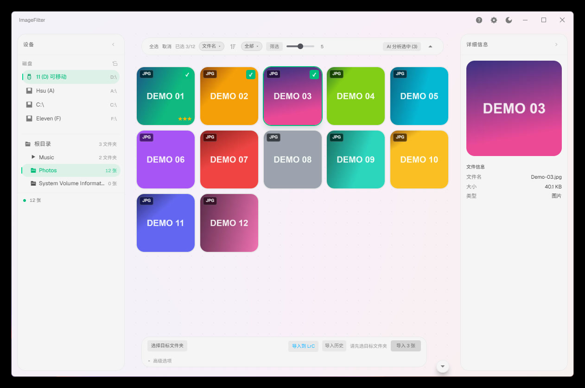
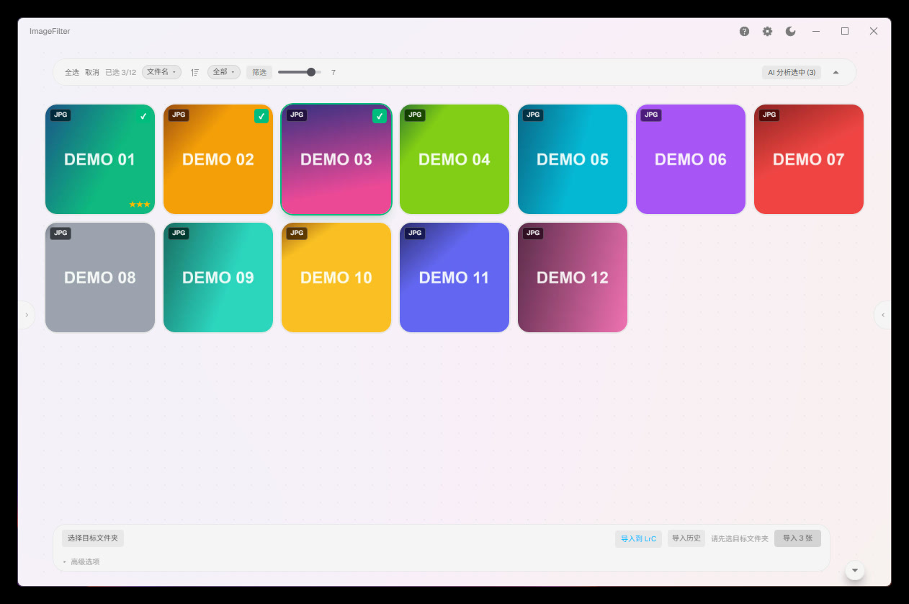
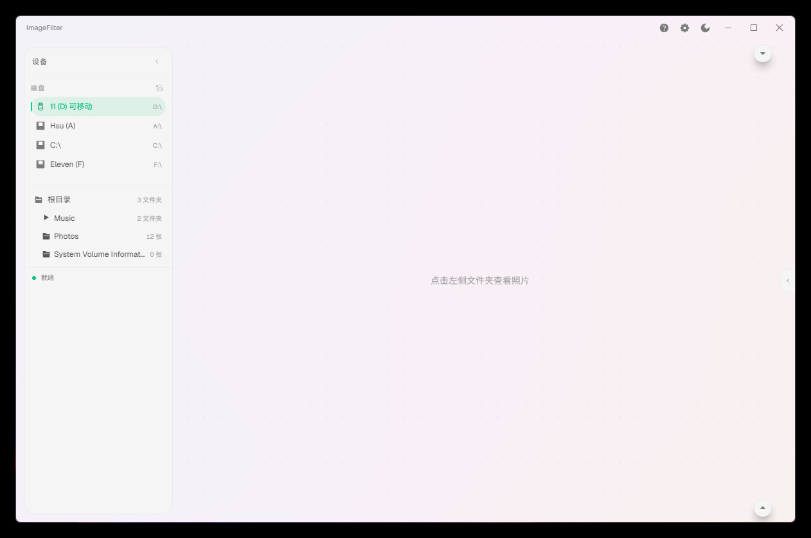
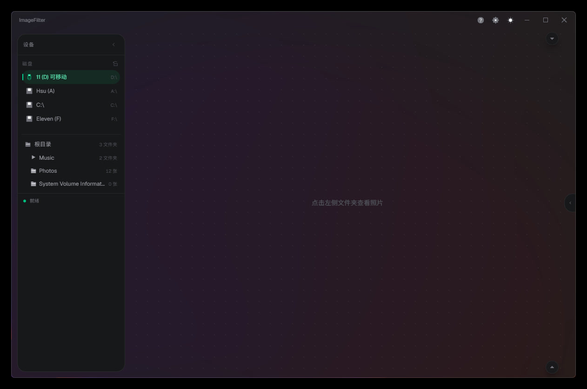

<p align="center">
  
</p>

<h1 align="center">ImageFilter</h1>

<p align="center">
  A RAW culling &amp; import tool — fast preview, cull, and archive. Everything stays local.
</p>

<p align="center">
  <a href="https://github.com/XUTENGXIANG/ImageFilter/releases/latest"></a>
  <a href="https://github.com/XUTENGXIANG/ImageFilter/actions/workflows/build.yml"></a>
  <a href="https://github.com/XUTENGXIANG/ImageFilter/actions/workflows/android.yml"></a>
  <a href="#"></a>
  <a href="LICENSE"></a>
  <a href="https://github.com/XUTENGXIANG/ImageFilter/releases/latest"></a>
</p>

<p align="center">
  <a href="https://tensyn.online/#download"></a>
  &nbsp;·&nbsp;
  <a href="README.md"></a>
</p>

---

## Contents

- [Overview](#overview)
- [Screenshots](#screenshots)
- [Installation](#installation)
- [Quick Start](#quick-start)
- [Tech Stack](#tech-stack)
- [Development](#development)
- [Project Structure](#project-structure)
- [Docs](#docs)
- [Known limitations](#known-limitations)
- [Contributing](#contributing)
- [Feedback & acknowledgements](#feedback--acknowledgements)
- [License](#license)

## Overview

The usual workflow imports the whole card into Lightroom first, then culls through thousands of photos. ImageFilter culls before import: browse straight from the card, rate with stars / `J` / `X`, then copy only the keepers to the destination folder.

A complete RAW first-pass culling workflow for photographers — insert the card, preview, rate, and archive.

- Grid thumbnail preview with instant browsing; LrC-style star ratings for the first pass
- Native support for mainstream RAW formats, with a dedicated built-in DNG decoder
- Automatic blur / overexposure / burst-duplicate detection to assist rating
- Template-based naming and auto-archiving; MD5 verification keeps data intact
- Everything is processed locally — photos never leave your machine

---

> **Development status**
> - Still in active development — ideas and feedback are welcome!
> - macOS builds may have known issues due to a lack of build environment; please file an issue if you hit one.
> - Thanks to all contributors!

---

## Screenshots

<table>
  <tr>
    <td align="center" width="50%"><a href="assets/screenshot-light-grid.jpg"></a><br><sub>Light · Main UI</sub></td>
    <td align="center" width="50%"><a href="assets/screenshot-light-clean.jpg"></a><br><sub>Light · Grid</sub></td>
  </tr>
  <tr>
    <td align="center" width="50%"><a href="assets/screenshot-light-empty.jpg"></a><br><sub>Light · Empty state</sub></td>
    <td align="center" width="50%"><a href="assets/screenshot-dark-empty.jpg"></a><br><sub>Dark · Empty state</sub></td>
  </tr>
</table>

Double-click a photo to open the fullscreen viewer: scroll to zoom, drag to pan, rotate, and rate directly from the viewer. The UI supports dark / light themes, Chinese / English switching, and the Windows Mica glass background.

## Installation

Download the installer for your platform from [Releases](https://github.com/XUTENGXIANG/ImageFilter/releases):

| File | Description |
|------|-------------|
| `ImageFilter_x64-setup.exe` | NSIS installer (recommended) |
| `ImageFilter_x64_zh-CN.msi` | MSI installer |
| `ImageFilter-Mobile-<version>.apk` | Android client (same LAN as the desktop app) |

Double-click to install. If downloads are slow, use the [official website](https://tensyn.online/#download) or the links on [Releases](https://github.com/XUTENGXIANG/ImageFilter/releases). macOS builds are available on [Releases](https://github.com/XUTENGXIANG/ImageFilter/releases).

The Android client connects over the local network: open **Settings → Gallery Service**
on the desktop, turn the service on, then pair by scanning the QR code or entering the
address manually. The service is off by default and listens on the LAN only.

## Quick Start

1. Connect an SD card or camera — the device is detected automatically in the left sidebar
2. Click the device, browse folders, and open the target folder to view photos
3. Single-click to select a photo (click again to deselect); `Shift`-click for range selection
4. Choose a destination folder at the bottom and click "Import"

### Keyboard Shortcuts

| Key | Action |
|-----|--------|
| `J` | Keep (3 stars) |
| `X` | Reject (0 stars) |
| `1`–`5` | Star rating |
| `←` / `→` | Previous / next photo in viewer |
| `R` / `Shift+R` | Rotate in viewer |
| `0` | Reset view in viewer |

### Naming Rules

Organize files automatically on import with templates:

- `{date}` — date taken (2026-08-10)
- `{camera}` — camera model (Sony_A7M4)
- `{seq}` — sequence number (0001)
- `{original}` — original file name

Example: `{date}/{camera}/{seq}.{ext}` produces `2026-08-10/Sony_A7M4/0001.ARW`

Resulting folder after import:

```text
2026-08-10/
  Sony_A7M4/
    0001.ARW
    0001.xmp
    0002.ARW
    0002.xmp
```

## Tech Stack

| Layer | Technology |
|-------|------------|
| Framework | Tauri 2, React 19, TypeScript |
| UI | Tailwind CSS 4, shadcn/ui, IconPark |
| RAW decoding | rawler, WIC, tinydng, zune-jpeg, fast_image_resize |
| Thumbnails | Windows Shell (WIC / IShellItemImageFactory) first, fallback to embedded preview + zune-jpeg; disk cache |
| Image analysis | image_hasher (perceptual hash) + Laplacian / histogram |
| Storage | SQLite (import history / rules) + XMP sidecars |
| Mobile | Android Compose, Coil 3, OkHttp |
| LAN service | axum 0.8, mDNS |

## Development

Requirements: Node.js 20+, stable Rust, MSVC Build Tools.

```bash
# Clone the repository
git clone https://github.com/XUTENGXIANG/ImageFilter.git
cd ImageFilter

# Install dependencies
npm install

# Development mode (hot reload)
npx tauri dev

# Build installers
npx tauri build
```

Build output goes to `src-tauri/target/release/bundle/`.

### Dev-mode notes (for developers)

`npx tauri dev` does three things in order:

1. Runs `beforeDevCommand` (`npm run dev`) to start the Vite dev server on port **1420**
2. Compiles the Rust backend (`src-tauri/`; 2–5 min on first run, incremental afterwards)
3. Launches `image-filter.exe` with the app window

Window config (`tauri.conf.json`): 1200×800, min 900×600, **borderless** (the title bar is a React component; drag via `data-tauri-drag-region`).

**Port 1420 occupied (common gotcha)**: stale vite processes survive window close and cause `beforeDevCommand terminated with non-zero status`.

```bash
netstat -ano | findstr ":1420" | findstr LISTEN   # find the PID
taskkill /PID <PID> /F                            # kill it, then restart
npx tauri dev
```

**Running in the background** (when the terminal is blocked):

```bash
npx tauri dev 2>&1 | tee dev.log
tasklist | findstr image-filter    # confirm the window process is up
```

**Hot reload**: frontend changes apply instantly via Vite HMR; Rust changes trigger an incremental rebuild and window restart. Before touching `viewer.tsx`'s loading state machine, read section 5 of `docs/ImageFilter-交接与上手.md` (every branch exists to fix a visual bug — don't "simplify" them).

**Versioning**: bump `package.json`, `tauri.conf.json` and `src-tauri/Cargo.toml` together;
Android reads `android/version.properties` and the Gradle build verifies it matches the
desktop files. Increment `versionCode` for every Android release. Tag `vX.Y.Z` and push;
the GitHub Actions workflows build the installers and APK.

## Project Structure

```
src/                  # React frontend
  App.tsx             # Main UI (three-pane layout + floating toolbars)
  useScanner.ts       # State management and business logic
  viewer.tsx          # Image viewer (progressive loading)
  i18n/               # Chinese / English translations
  components/         # Floating panels / toolbars / photo cards
src-tauri/            # Rust backend
  src/
    scanner/          # Devices / browsing / EXIF / image decoding
    server/           # Embedded LAN gallery service (axum + mDNS + pairing)
    analyzer.rs       # Blur / exposure / duplicate detection
    importer.rs       # Import engine
    win_wic.rs        # Windows WIC decoding
    tinydng.rs        # DNG decoding (FFI)
  third_party/tinydng # DNG decoder C++ sources
android/              # Android Compose client
docs/                 # Handoff docs, project log, SDD plans and evidence
```

## Docs

- [Handoff & onboarding](docs/ImageFilter-交接与上手.md) — read this first
- [Documentation index](docs/README.md) — all docs, archive and SDD
- [Release notes](docs/ImageFilter-更新说明.md) — version changes

## Known limitations

- macOS builds are not fully verified on real hardware; include the OS version and reproduction steps in issues.
- The Android client is LAN-only: enable Gallery Service on the desktop and keep both devices on the same network.
- Lightroom handoff is Windows-only; silent import is not supported yet.
- There is no delete action; XMP writes only sidecars and never modifies originals.

## Contributing

Read [Handoff & onboarding](docs/ImageFilter-交接与上手.md) first — the code map, invariants and verification tools live there.

For issues, include the version, OS and reproduction steps. For UI changes, attach a screenshot or recording; for import or sidecar changes, include the test files and results.

## Feedback & acknowledgements

Report issues and suggestions via [GitHub Issues](https://github.com/XUTENGXIANG/ImageFilter/issues).

The project builds on Tauri, rawler, image_hasher, axum and other open-source projects; thanks to their maintainers.

## License

Released under the **MIT License** — full text in [LICENSE](LICENSE).

You may use, modify and distribute this software freely, including in closed-source commercial products; just keep the copyright notice and the license text. The software is provided "as is", without warranty of any kind.

Copyright holder: **XUTENGXIANG** (2026).

That requirement is wired into the distribution path: the Windows installers (NSIS / MSI) show the license in the setup wizard and drop a `LICENSE.txt` into the install directory (removed on uninstall), and every source file carries `SPDX-License-Identifier: MIT`.

